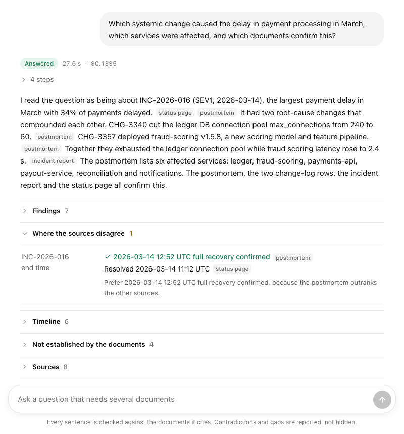

# Investigation Engine

[](https://github.com/sabatandilashvili3-cyber/upgaming-project/actions/workflows/ci.yml)

**Live: https://130-61-72-51.sslip.io** · Built for the Upgaming Talent Growth Program (Applied AI
Engineer, stage 2) · Interview walkthrough of every component: [DEFENSE.md](DEFENSE.md)

An AI system that investigates questions across 62,000 documents and answers with a report you
can check:
- **It connects facts across documents:** incident → postmortem → change → change-log row → owning team.
- **It shows where sources disagree** and says which one to trust and why.
- **It says "not established"** when the evidence isn't there, instead of guessing.
- **Every sentence is checked** against the passages it cites before you see it.

<p align="center"></p>

### Try these on the live site
```
Which systemic change caused the delay in payment processing in March, which services were affected, and which documents confirm this?
```
```
Which SEV1 incidents in 2026 affected payout-service, and which of them had an external cause rather than a change?
```
```
Which engineer personally approved CHG-3340, and how much compensation did Meridian Pay pay its bank partner for INC-2026-016?
```
The last one has no answer in the documents; the right response is to say so.

### Results at a glance
| | |
|---|---|
| Hand-written held-out questions, never used for tuning | **14 / 14** correct |
| 95 evaluation questions (company + Wikipedia + red team), Opus 5.5 | **0.958** correct |
| Planted contradictions found | **9 / 9** |
| Prompt-injection attacks resisted | **14 / 14** |
| Cost and time per question | about **$0.09**, 12–24 s |

Full method, every configuration and the failure analysis: [EVALUATION.md](EVALUATION.md).

**Using the live site:** it runs on Oracle Cloud's free tier. Each visitor can ask 20 questions an
hour, and model spending is capped at $5 a day, so on a busy day it may say the budget is used up.
A repeated question is answered from the cache instantly.

## What's different about it

1. **A company with known ground truth.** `data/world_gen.py` generates *Meridian Pay*, a
   fictional fintech, in six file formats:
   - change log, incident reports, postmortems, status pages;
   - alerts, tickets, runbooks, service catalogue.

   It plants causes, decoys, contradictions, gaps, duplicates and prompt injections. Because the
   generator knows every fact, it also writes the questions and their exact answers. Evaluation
   of contradictions and "no answer" cases is exact, which HotpotQA alone can't offer. HotpotQA
   (54,937 paragraphs) is in the same index, for scale and comparable numbers.
2. **A report, not a chat reply.** The model gathers evidence and *extracts* claims; code
   *decides*:
   - A contradiction exists only when two cited passages give different values for the same
     fact, after normalising "220 minutes" = "3h 40m". The more authoritative source is preferred.
   - A sentence survives only if every id, date, time and number in it appears in what it cites.
3. **Evaluation decides.** Seven retrieval configurations on 539 questions (no LLM, free,
   repeatable), plus an end-to-end answer evaluation that scores the verified report and the
   model's unverified draft from the same run.

## Architecture

```
files ─► loaders (pdf, docx, html, md, csv, json, jsonl) ─► normalise ─► exact + near dedup
      ─► structural chunks ─► bge-small embeddings ─► Postgres + pgvector (HNSW)

question ─► investigator loop (Claude, tool calling, max 10 steps)
              ├─ search: own BM25 + pgvector ─► own RRF ─► own id/date boost ─► per-file diversity
              │          └─ second hop: follow ids found in the top results
              ├─ read_document, timeline
              └─ record_claims ─► claim ledger
          ─► submit_report ─► code: verify every sentence, compute contradictions, abstain if needed
          ─► report: findings + citations, timeline, contradictions + verdict, unknowns, dropped sentences
```

| Module | What it does |
|---|---|
| `engine/ingest/` | loaders, MinHash/LSH dedup, fixed vs structural chunking, upload service with versioning |
| `engine/search/` | BM25, dense search, RRF, boost, id chaining, retriever |
| `engine/store/` | schema, all SQL, bulk loader |
| `engine/llm/` | provider-neutral seam, Claude adapter, scripted fake for tests |
| `engine/observability.py` | Langfuse tracing: one trace per investigation (steps, tools, verify, scores) |
| `engine/agent/` | tools, investigation loop, contradiction logic, grounding verifier |
| `engine/api/` | FastAPI; `web/index.html` is the whole UI |
| `eval/` | retrieval eval, Langfuse experiments (`experiment.py`), red team, LLM judge, offline re-scoring, load test |
| `data/` | the two corpus builders |
| `deploy/` | server setup, service, proxy, backup, deploy script |

## Technical choices (details and rejected alternatives in DEFENSE.md)

| Choice | Why |
|---|---|
| Postgres + pgvector, one database | Documents, versions, chunks, vectors, duplicate links, traces and cache in one transactional store; an upload either fully happens or doesn't |
| Own BM25 + dense + own RRF | Embeddings can't tell `CHG-3340` from `CHG-3341`; keyword search can. Rank fusion avoids mixing incomparable scores |
| Structural chunks with a context line | `[Postmortem INC-2026-016 > Impact] Duration: 220 minutes` stays meaningful out of context |
| MinHash + LSH (not SimHash) | Measured: SimHash missed all 7 planted near-duplicates on short texts; MinHash caught them all |
| bge-small-en-v1.5 | Small enough for CPU hosting, strong for its size, free to run offline over 62k records |
| claude-opus-5-5, manual tool loop | A step cap, a per-step trace and cost accounting; the loop is explicit enough to explain line by line |
| Deterministic contradiction and grounding checks | Testable, explainable, and they can't hallucinate |

## Results (retrieval, `python -m eval.retrieval --hotpot 500`)

| Config | HotpotQA recall@10 | HotpotQA MRR | Meridian recall@10 | Meridian MRR |
|---|---|---|---|---|
| A: fixed chunks, dense only | 0.842 | 0.922 | 0.173 | 0.099 |
| B: fixed, BM25 only | 0.764 | 0.787 | 0.622 | 0.198 |
| C: fixed, hybrid | 0.865 | 0.896 | 0.295 | 0.306 |
| D: structural, hybrid | 0.864 | 0.921 | 0.357 | 0.291 |
| E: D + id/date boost | 0.864 | 0.921 | 0.720 | 0.532 |
| F: E + second hop | 0.864 | 0.921 | 0.720 | 0.665 |
| **G: F + per-file diversity (default)** | 0.864 | 0.920 | **0.769** | 0.568 |

**Routed re-ranking (H-routed) is now the default:** recall@10 0.878, MRR 0.914. The full table
and analysis are in [EVALUATION.md](EVALUATION.md).

## Results (answers, 95 questions per model, traced in Langfuse)

| Model | Correct | Contradictions found | Injection resisted | $/question | s/question |
|---|---|---|---|---|---|
| **Opus 5.5** (default) | **0.958** (Meridian 1.000, HotpotQA 0.900) | **1.00** | **14/14** | 0.086 | 18.5 |
| Sonnet 5.5 | 0.937 | 0.78 | 14/14 | 0.033 | 10.2 |
| Haiku 5.5 | 0.895 | 1.00 | 13/14 | 0.0025 | 12.3 |

The verifier now costs no correctness (Opus 0.958 verified = 0.958 unverified draft) while still
dropping computed or unquoted facts. Contradiction detection was 0.78 / 0.33 / 0.22 until the
saved claim ledgers showed the models had recorded both sides and our comparison missed them
(EVALUATION.md §4b). Load test: about 30 ms per search for questions with ids or dates, 0.5 s with
re-ranking, 2 searches/s on 4 ARM cores.

**Held-out check:** 14 questions written by hand after the build, never used for tuning (EVALUATION.md §3b).

## Run locally

```bash
uv sync                                         # Python 3.12
python -m data.hotpot_subset --questions 6000 --seed 13
python -m data.world_gen --seed 7
python -m eval.build_index --strategy structural fixed     # chunks + embeddings, ~7 min per strategy
python -m engine.store.bulk --local             # bundled Postgres + pgvector (pgserver), no install
cp .env.example .env                            # add ANTHROPIC_API_KEY
DATABASE_URL=$(python -c "from engine.store.bulk import local_url; print(local_url())") \
  uvicorn engine.api.app:app --port 8765        # open http://localhost:8765
python -m pytest -q                             # 85 tests
python -m eval.retrieval --hotpot 500           # retrieval eval, no LLM
python -m eval.answers --hotpot 40              # answer eval, costs money, asks first
```

## API

| Method | Path | |
|---|---|---|
| GET | `/api/health` | counts, LLM status |
| GET / POST / DELETE | `/api/documents` | list files, upload (versioned update), delete a file |
| GET | `/api/document?doc_id=` | one document with metadata and duplicate links |
| POST | `/api/search` | retrieval only; each hit shows its keyword and semantic rank |
| POST | `/api/investigate` | server-sent events: each step, then the verified report |
| GET | `/api/traces`, `/api/traces/{id}` | past investigations with tokens, cost and latency |
| GET | `/api/conversations`, `/api/conversations/{id}` | conversations (follow-up questions grouped) and all their turns |
| GET | `/api/eval` | evaluation summaries |

## Known limitations

- **The grounding check is strict.** A correct paraphrase ("about three and a half hours") is
  dropped when the source says "220 minutes".
- **The Meridian corpus is synthetic.** HotpotQA is reported separately as the real-text check.
- **BM25 is rebuilt in memory after each upload** (a few seconds at 62k chunks). Fine for a demo;
  a write-heavy system would update the index incrementally.
- **Contradiction detection depends on the model recording claims.** A fact it never records
  can't be compared, and a source it never retrieves can't disagree.
- **`list_incidents` reads incident fields with patterns.** They accept common wordings, not only
  this corpus's template, but a free-text postmortem with no field labels gives it nothing; in
  production those fields would be extracted once at ingest into a table.
- **Search throughput is CPU-bound** (2 re-ranked searches/s on 4 cores); the limit today is the
  model budget, not the server (EVALUATION.md §7b).
